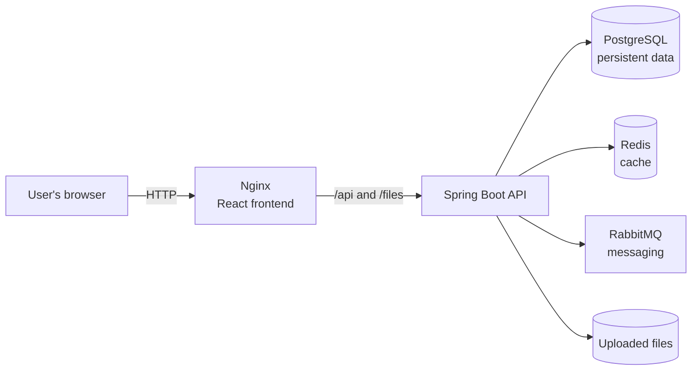

<p align="center">
  
</p>

# TwittVL

A full-stack social application inspired by Twitter/X. Create an account, share
posts, follow people, and keep up with conversations and notifications.

TwittVL can be started as a complete Docker application, either with prebuilt
container images or by building those images from this repository. You can also
run the frontend and backend separately for development.

## What you can do

- Register and sign in with JWT-based authentication and refresh tokens.
- Browse a feed, publish posts, and take part in conversations with comments
  and replies.
- Like, repost, bookmark, and quote posts.
- View profiles and follow or unfollow other users.
- Receive notifications and use night mode.

## Technology

| Area | Technologies |
|---|---|
| Frontend | React 19, TypeScript, Vite, Tailwind CSS |
| Backend | Java 25, Spring Boot 4 |
| Data and messaging | PostgreSQL, Redis, RabbitMQ |
| Container deployment | Docker Compose, Nginx, GitHub Container Registry (GHCR) |

## How the application fits together

The browser loads the React application from Nginx. Nginx also forwards API and
uploaded-file requests to the Spring Boot backend. The backend uses PostgreSQL
for persistent data, Redis for caching, and RabbitMQ for message handling.



## Run the complete application with Docker

This is the simplest way to try TwittVL. Docker runs the frontend, backend, and
the PostgreSQL, Redis, and RabbitMQ services together; you do not need to
install Java or Node.js on the host computer.

### Requirements

- Docker Desktop on Windows or macOS, or Docker Engine with the Compose plugin
  on Linux.
- TCP port **80** available on the computer running Docker.
- Internet access to download the container images (unless you build them
  locally).

### 1. Get the project and create its environment file

```bash
git clone https://github.com/VeliAhmedov/twitter-clone.git
cd twitter-clone
```

Copy the supplied environment template to the repository root, next to
`compose.prod.yaml`:

```bash
cp backend/.env.example .env
```

On Windows PowerShell, use:

```powershell
Copy-Item backend\.env.example .env
```

Edit `.env` and set your own values:

| Variable | What it is for |
|---|---|
| `DB_USERNAME`, `DB_PASSWORD` | Credentials for the PostgreSQL database. |
| `RABBITMQ_USERNAME`, `RABBITMQ_PASSWORD` | Credentials for RabbitMQ. |
| `JWT_SECRET` | Private signing secret for authentication tokens. Generate a strong value, for example with `openssl rand -base64 32`. |
| `APP_URL` | Optional browser-facing application origin. Defaults to `http://localhost`; set it when accessing the app by a LAN IP or domain. |

Keep `.env` private and do not commit it to Git.

### 2. Start TwittVL

To download the published images from GHCR:

```bash
docker compose -f compose.prod.yaml pull
docker compose -f compose.prod.yaml up -d
```

The GHCR packages must be public for an unauthenticated pull. If they are
private, sign in to `ghcr.io` with an account that can access them before
running `pull`.

Alternatively, build the images from the checked-out source code:

```bash
docker compose -f compose.prod.yaml up -d --build
```

Open [http://localhost](http://localhost) on the computer running Docker.
The first startup can take a little while as services initialize.

### Use TwittVL from another computer

For another device on the **same local network**:

1. Find the LAN IP address of the computer running Docker (for example,
   `192.168.1.50`).
2. Set `APP_URL` in the root `.env` file to that computer's address, for
   example `APP_URL=http://192.168.1.50`. Include the scheme (`http://`) and
   use the same origin that people enter in their browsers.
3. Restart the application so the backend picks up the CORS origin:

   ```bash
   docker compose -f compose.prod.yaml up -d
   ```

4. On the other computer, open `http://192.168.1.50` in a browser, replacing
   the example address with the Docker host's actual LAN IP.

Allow inbound TCP port 80 through the host computer's firewall for your
trusted local network if necessary. The current production Compose file binds
the application to port 80.

For access **over the public internet**, deploy to a host with a public
address, configure DNS and HTTPS with a reverse proxy, and set `APP_URL` to
the public HTTPS origin. Configure the host firewall and network deliberately;
do not expose a development machine or internal database, Redis, or RabbitMQ
ports directly to the internet.

### Manage the running application

```bash
# See service status
docker compose -f compose.prod.yaml ps

# Follow application logs
docker compose -f compose.prod.yaml logs -f

# Stop the services (database and uploaded-file data are retained)
docker compose -f compose.prod.yaml down

# Remove services and their persisted data
docker compose -f compose.prod.yaml down -v
```

To update to the latest published images, pull them and recreate the services:

```bash
docker compose -f compose.prod.yaml pull
docker compose -f compose.prod.yaml up -d
```

## Run from source (development)

### Requirements

- Java 25
- Node.js 22 and npm
- Docker with Docker Compose

### 1. Configure and start the backend services

From the repository root, copy the backend environment template:

```bash
Copy-Item backend\.env.example backend\.env
```

On macOS or Linux, use `cp backend/.env.example backend/.env` instead. Set the
database, RabbitMQ, and JWT values in `backend/.env`, then start PostgreSQL,
Redis, and RabbitMQ:

```bash
cd backend
docker compose up -d
```

### 2. Start the backend

The backend process also needs `DB_USERNAME`, `DB_PASSWORD`, and `JWT_SECRET`
in its environment. Set them to the same values as in `backend/.env`.

In Windows PowerShell, for example:

```powershell
$env:DB_USERNAME = "your_db_user"
$env:DB_PASSWORD = "your_db_password"
$env:JWT_SECRET = "your_generated_jwt_secret"
.\mvnw.cmd spring-boot:run
```

On macOS or Linux, use:

```bash
export DB_USERNAME=your_db_user
export DB_PASSWORD=your_db_password
export JWT_SECRET=your_generated_jwt_secret
./mvnw spring-boot:run
```

The backend API is available at [http://localhost:8085](http://localhost:8085).

### 3. Start the frontend

Open another terminal at the repository root:

```bash
cd frontend
npm ci
npm run dev
```

Open [http://localhost:5173](http://localhost:5173). The development frontend
uses `frontend/.env.development` to connect to the backend at
`http://localhost:8085`.

### Database access

With the development services running, connect to PostgreSQL from the
`backend` directory with:

```bash
docker compose exec postgres psql -U YOUR_DB_USERNAME -d mydatabase
```

Replace `YOUR_DB_USERNAME` with the `DB_USERNAME` value from `backend/.env`.
Enter `\q` in `psql` to exit.

## CI/CD

GitHub Actions automates checks and container publishing:

- **CI** builds and tests the backend, checks the frontend with TypeScript and
  ESLint, builds it, and runs dependency/security scans and SonarCloud analysis.
- **CD** builds and starts the full five-container application, smoke-tests
  the frontend and API, and publishes the frontend and backend images to GHCR
  when the smoke test succeeds.

## TODOs

- [x] Limit notification sizing so the notification list does not overflow
  (completed).
- [ ] Add a JWT revocation blocklist using `jti` to reduce the risk of a stolen
  account remaining usable for the lifetime of an access token.
- [ ] Add online presence or session status, similar to WhatsApp's online
  indicator.
- [ ] After adding `AuthenticationPrincipal`, replace explicit user lookups
  with `getReferenceById` where appropriate when saving.
- [ ] Revisit unbookmark checks: consider loading the joined record rather than
  checking existence using only the tweet and user IDs.
- [ ] Add a shell script for applying externally added constraints after
  deployment, and provide equivalent setup for RabbitMQ and Redis.
